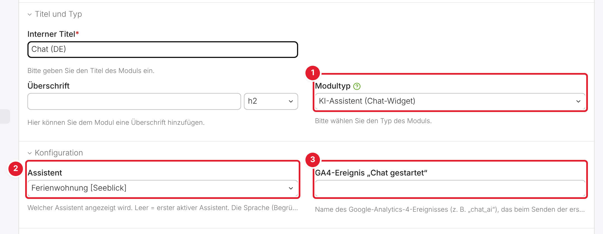

# Einrichtung

Die Schritte in dieser Reihenfolge erledigen. Die Schritte 2 und 3 laufen unter
**NEO Digital › Zugänge und Lizenzen** (Seite des Basic-Bundles); die Liste der
Assistenten hat eine gleichnamige Schaltfläche. Das Einrichten der Assistenten
selbst beschreibt die [Bedienungsanleitung](usage/README.md).

## 1. Stufen und Lizenz

**Lizenzschlüssel:** <https://store.neo-digital.at/extensions/superagent>

| | Ohne Lizenz (kostenlos) | Basic | Plus | Pro |
| --- | --- | --- | --- | --- |
| Chat mit Antworten aus der Wissensquelle und den Fragen & Antworten | ja | ja | ja | ja |
| KI-Hinweis, Sicherheitsregeln (Medizin, Datenschutz), Sprachen, Gespräch über Seiten hinweg, Gestaltung über CSS-Variablen | ja | ja | ja | ja |
| Hinweis „powered by“ im Chatfenster | sichtbar | – | – | – |
| **Navigation**: Der Assistent öffnet Seiten der Website | – | ja | ja | ja |
| **Kontakt**: Weiterleiten-Formular im Chat, vom Assistenten vorbefüllt; Öffnen der Kontaktseite | – | ja | ja | ja |
| **Internetsuche** auf freigegebenen Websites | – | ja | ja | ja |
| **Werkzeuge von MCP-Servern**: Verbindungen mit Anmeldung, Werkzeuge mit Sperren, Auswahl je Assistent, Werkzeugprotokoll | – | – | ja | ja |
| **Installierte Skills** aus GitHub oder einer Datei, Auswahl je Assistent | – | – | ja | ja |
| **Spracheingabe**: Der Besucher spricht, der Text erscheint im Eingabefeld | – | – | – | ja |

**Lizenz eintragen.** Unter *Zugänge und Lizenzen*, Abschnitt **Lizenzen**, den
Schlüssel in der Zeile *SuperAgent* eintragen (1 im Bild) und speichern. Welche Stufe gilt,
entscheidet allein der signierte Nachweis des Lizenzdiensts für die Domain, auf
dem Server. Der Stand der Zeile sagt, was jede Stufe ergänzt. Der Browser prüft
den Nachweis, bevor er den Hinweis weglässt; dafür braucht es HTTPS.


Im Bild: 1 der Lizenzschlüssel des SuperAgent, 2 sein Stand (hier: ohne Lizenz,
mit dem Link zum Store), 3 der Abschnitt **Bedingungen der Erweiterungen**
(Schritt 3), 4 **Route** und 5 **Schlüssel** der KI-Verbindung (Schritt 2), 6
**Verbindung prüfen**.

Der Schlüssel wird beim Speichern und einmal täglich beim Lizenzdienst geprüft.
Übertragen werden nur der Schlüssel, der Code der Erweiterung, die Domains der
Website und die Versionen, keine Daten von Besuchern. Ist der Dienst nicht
erreichbar, gilt die letzte Bestätigung bis zum Ende ihrer Schonfrist weiter.

Einstellungen von Funktionen, die die Lizenz nicht enthält, zeigt das Backend
nicht: die Abschnitte *Spracheingabe*, *Internetsuche*, *Eskalation &
Einwilligung*, *Installierte Skills* und *Werkzeuge der Verbindungen* sowie die
Schaltflächen **Verbindungen** und **Skills** über der Liste. Ihre gespeicherten
Werte bleiben und erscheinen mit einer passenden Lizenz wieder.

## 2. KI-Verbindung und API-Schlüssel

Unter *Zugänge und Lizenzen*, Abschnitt **KI-Verbindung**, die **Route** wählen
(4 im Bild oben), den **Schlüssel** eintragen (5) und speichern (siehe
Dokumentation des Basic-Bundles). **Verbindung prüfen** (6) fragt die Route
nach ihren Modellen und sagt, ob sie antwortet. Die
Verbindung teilen sich alle Erweiterungen; jeder Assistent wählt sein eigenes
Modell. Solange kein Schlüssel gespeichert ist, zeigt die Website den Chat
nicht, und die Liste der Assistenten sagt es („Noch kein KI-Schlüssel
hinterlegt. …“).

| Anbieter | Woher der Schlüssel kommt | Hinweise |
| --- | --- | --- |
| **Requesty** ([requesty.ai](https://www.requesty.ai/)) | Konto › *API keys* › neuer Schlüssel | Route **Requesty, EU-Route (Verarbeitung in der EU)** für die Verarbeitung in der EU. Modell-IDs haben die Form `anbieter/modellname`. Für die Spracheingabe bei Requesty unter *Transcriptions* ein Umschrift-Modell freigeben. |
| **OpenAI** ([platform.openai.com](https://platform.openai.com/)) | *API keys* › neuer Schlüssel | Route *OpenAI (direkt)*; das Modell ist eine ID aus der Modellliste des Kontos, ohne Anbieter-Präfix |
| **Eigene Adresse** | – | Route *Eigene Adresse (OpenAI-kompatibel)*. Der Dienst braucht `POST {adresse}/chat/completions` und `GET {adresse}/models`; für die Spracheingabe zusätzlich `POST {adresse}/audio/transcriptions` und, für die Liste im Backend, `GET {adresse}/models/transcription`. |
| **SerpAPI** ([serpapi.com](https://serpapi.com/)) | Konto › API-Schlüssel | Nur für die Internetsuche über eine Suchmaschine. Abschnitt **Internetsuche (SerpAPI)**, Feld **SerpAPI-Schlüssel**. Ohne ihn liest ein auf SerpAPI gestellter Assistent die freigegebenen Quellen direkt. |

Alle Schlüssel werden verschlüsselt gespeichert (libsodium, Schlüssel aus dem
App-Secret) und nie wieder angezeigt.

## 3. Bedingungen

Die Bedingungen der Erweiterung werden einmal je Installation unter *Zugänge und
Lizenzen*, Abschnitt **Bedingungen der Erweiterungen**, bestätigt: eine Passage
für alle Stufen und eine je Stufe (Antworten der KI, Sicherheitsregeln,
Datenschutz, Kosten; Internetsuche und Weiterleitung; MCP-Server, Skills und
Wissensquellen; Aktionen mit Folgen und Spracheingabe). Sie erscheinen in der
Backend-Sprache; verbindlich ist der deutsche Text.

1. Den Abschnitt **Bedingungen der Erweiterungen** mit einem Klick auf seine
   Überschrift öffnen.
2. Jede Passage lesen: **Text anzeigen** öffnet sie (1 und 2 im Bild).
3. **Ich habe die Bedingungen gelesen und akzeptiere sie.** anhaken (3) und auf
   **Bestätigen** klicken (4).


Im Bild: 1 die Erweiterung und die Stufe, zu der die Passagen gehören, mit ihrem
Stand, 2 eine Passage (**Text anzeigen** öffnet sie, mit der deutschen Fassung
darunter), 3 das Häkchen, 4 **Bestätigen**. Danach steht dort „Bestätigt von …
am …“.

- Ein Assistent lässt sich erst nach der Bestätigung auf **Alle Besucher**
  stellen. Bis dahin bleibt er in der Vorschau („Bitte bestätigen Sie zuerst
  die Bedingungen unter „Zugänge und Lizenzen“. …“).
- Die Funktionen einer Stufe bleiben gesperrt, bis ihre Passage bestätigt ist
  („Die Funktionen der Stufe … sind gesperrt, bis ihre Bedingungen bestätigt
  sind.“).
- Eine höhere Stufe oder eine geänderte Passage fragt neu; die Liste der
  Assistenten sagt es mit einem Link.

## 4. Der Chat auf der Website

1. Einen Assistenten anlegen (siehe
   [Bedienungsanleitung](usage/assistant.md)). Ein neuer Assistent steht zuerst
   auf **Nur Vorschau**.
2. **Layout › Themes › Frontend-Module** öffnen, auf **Neu** klicken und den
   Modultyp **KI-Assistent (Chat-Widget)** wählen (Gruppe *NEO Digital*; 1 im
   Bild).
3. Abschnitt *Konfiguration*:
   - **Assistent** (2): welchen Assistenten das Widget zeigt. Leer: der erste
     aktive Assistent.
   - **GA4-Ereignis „Chat gestartet“** (3, optional): der Name eines
     Google-Analytics-4-Ereignisses, z. B. `chat_ai`, gesendet bei der ersten
     Nachricht, nur nach Einwilligung in die Statistik. Gesendet wird nur der
     Name des Ereignisses, nie ein Inhalt.

   
4. Das Modul in das Seitenlayout setzen, meist in die Fußzeile. Ein Modul reicht
   für alle Seiten des Layouts.

Für Websites in mehreren Sprachen: ein Assistent je Sprache (mit eigenen
Texten und, wo nötig, eigenem Wissen und eigener Weiterleitungsadresse) und
ein Modul je Sprache im Layout dieser Sprache. Schritt für Schritt:
[Mehrere Sprachen auf der Website](usage/languages.md#mehrere-sprachen-auf-der-website).

## 5. Absender

Weitergeleitete Anfragen gehen über den Mailversand von Contao. Absender ist die
erste dieser Adressen, die gesetzt ist:

1. die Umgebungsvariable `MAILER_FROM` oder der Parameter in
   `config/config.yaml`:

   ```yaml
   parameters:
       neo_super_agent.from_email: 'office@example.com'
   ```

2. die **E-Mail-Adresse des Webseiten-Administrators** beim Startpunkt der Seite
   (Einstellungen des Startpunkts in der Seitenstruktur);
3. die **E-Mail-Adresse des Systemadministrators** unter **System ›
   Einstellungen**.

Ohne eine davon wird eine Anfrage nicht gesendet: Der Chat zeigt seinen
Fehlerhinweis statt der Bestätigung, das Protokoll nennt den Grund, und das
Formular des Assistenten warnt im Abschnitt **Eskalation & Einwilligung**,
welche Startpunkte betroffen sind.

Als Absendername zeigt die E-Mail den Namen des Assistenten. Die Adresse des
Besuchers ist die Antwortadresse; die E-Mail enthält die Nachricht und das
bisherige Gespräch.

## 6. Einwilligungswerkzeug

Jeder Assistent hat eine **Einwilligungs-Kategorie** (Funktional, Statistik,
Marketing oder keine). Der Chat wartet auf die Einwilligung in dieser Kategorie,
wenn die Seite eine dieser Schnittstellen hat:

- `window.cookieConsent.allows(kategorie)` mit dem Ereignis
  `cookie-consent:change` auf `window`, wie NEO Cookie Consent sie bietet;
- für jedes andere Einwilligungswerkzeug `window.superAgentConsent(kategorie)`
  mit dem Ereignis `superagent:consent-change` auf `window`, aus einem kleinen
  Skript der Website ([Anpassen](customising.md#einwilligung)).

Ohne eine davon, oder mit der Kategorie *Keine Einwilligung nötig (Chat sofort
verfügbar)*, ist der Chat sofort verfügbar. Ohne Einwilligung wird nichts
gesendet und nichts im Browser behalten. Einzelheiten:
[Anpassen](customising.md#einwilligung).

Mit NEO Cookie Consent braucht die Kategorie dort einen aktiven Dienst, den
Dienst *KI-Chat-Assistent* in derselben Kategorie; sonst fragt sein Banner nie
danach. Dann sagt das Feld **Einwilligungs-Kategorie** das in Rot, mit dem Link
**Dienst jetzt anlegen** (für Benutzer, die das Modul *Cookie-Hinweis* öffnen
dürfen), der den Dienst in dieser Kategorie anlegt und öffnet. Im Chatfenster
lesen Besucher, dass der Chat derzeit nicht verfügbar ist, statt einer Bitte um
Einwilligung, die sich nicht erfüllen lässt. Wo das Banner gar nicht erscheint
(kein Dienst braucht eine Einwilligung), startet der Chat ohne Nachfrage.

## 7. Server-Konfiguration

| Parameter (`config/config.yaml`, Abschnitt `parameters`) | Vorgabe | Bedeutung |
| --- | --- | --- |
| `neo_super_agent.from_email` | leer | Absender weitergeleiteter Anfragen, wenn `MAILER_FROM` nicht gesetzt ist |
| `neo_super_agent.max_steps` | `12` | Höchstzahl der Modellaufrufe je Antwort (das Laden eines Skills zählt mit); im letzten Schritt bekommt das Modell keine Werkzeuge und schreibt seine Antwort |

Eigene Vorlagen für Verbindungen zu MCP-Servern kommen nach
`config/superagent/mcp-templates/<id>/` (siehe
[Verbindungen zu MCP-Servern](usage/connections.md#vorlagen)).
