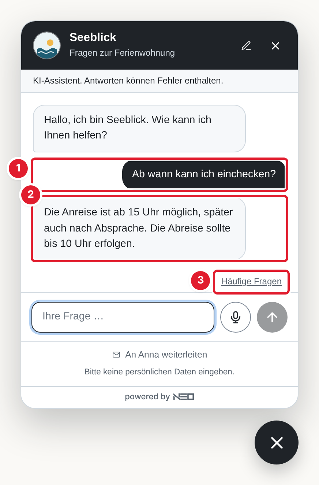
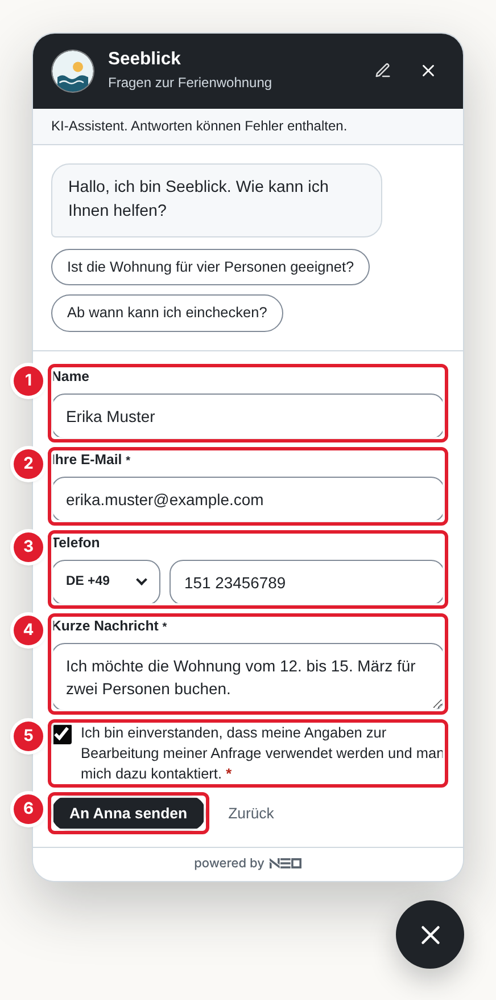

# Der Chat auf der Website

## Fenster

Ein runder Knopf öffnet das Fenster in der gewählten Ecke. Teilen sich Knöpfe
anderer Erweiterungen diese Ecke (der Knopf zum Wiederöffnen der
Cookie-Einstellungen, die Schaltfläche eines Barrierefreiheits-Panels),
ordnen die Schaltflächen am Bildschirmrand von NEO Basic sie an, wie es im
Seitenlayout eingestellt ist (**Schaltflächen am Bildschirmrand**): Mit *Eine
Einstellungs-Schaltfläche mit Menü* (der Vorgabe) weicht der Chat-Knopf einer
Einstellungs-Schaltfläche mit Zahnrad, und der Eintrag mit der Beschriftung
des Chat-Knopfs (z. B. „Nova — Chat öffnen“) öffnet das Fenster über der
Einstellungs-Schaltfläche; übereinander oder nebeneinander bleibt der
Chat-Knopf, am nächsten an der Ecke. Schließt sich das Fenster, kehrt der
Fokus dorthin zurück, wo er beim Öffnen war (die Einstellungs-Schaltfläche
oder der Chat-Knopf).

Das Fenster hat:

- den Kopf mit Bild oder Roboter-Icon, Anzeigename, Untertitel, **Neues
  Gespräch** und dem Knopf zum Schließen;
- unter dem Kopf immer den KI-Hinweis: Besucher erfahren, dass sie mit einer KI
  schreiben (EU-KI-Verordnung, Artikel 50);
- die Begrüßung und die Einstiegsfragen als Knöpfe. Sie stehen unter der
  Begrüßung, bis der Besucher eine davon stellt, auch im wiederhergestellten
  Gespräch auf der nächsten Seite; der Knopf **Häufige Fragen** über der Eingabe
  zeigt sie jederzeit wieder;
- das Eingabefeld mit dem Senden-Knopf; mit Spracheingabe (Pro) daneben das
  Mikrofon;
- unter der Eingabe **An … weiterleiten** (Basic, mit Eskalationsadresse) und,
  mit Datenschutz-Modus, den Datenschutzhinweis;
- ohne Lizenz unten den Hinweis.

Im Bild: 1 **Neues Gespräch**, 2 der KI-Hinweis, 3 die Einstiegsfragen, 4 das
Eingabefeld (der Pfeil daneben sendet), 5 das Mikrofon (Pro), 6 **An …
weiterleiten** mit dem Namen, der am Assistenten eingestellt ist, 7 der
Chat-Knopf, der das Fenster öffnet und schließt. Unten der Hinweis der
Gratisfassung; mit Lizenz fehlt er.

Im Bild: 1 die Einstiegsfrage, die der Besucher angeklickt hat, 2 die Antwort,
die der Assistent aus der bei der Frage hinterlegten Antwort formuliert, 3
**Häufige Fragen**, das die Einstiegsfragen wieder zeigt.

Während der Assistent arbeitet, sagt die Antwortblase, was er tut: „Denkt nach
…“, „Sucht die passende Seite …“, „Bereitet das Formular vor …“, „Sucht im
Internet …“. Das eigene Nachdenken des Modells wird nie gezeigt.

Mit einer Einwilligungs-Kategorie und ohne Einwilligung bittet das Fenster
zuerst um Einwilligung; sein Knopf öffnet die Einstellungen des
Einwilligungswerkzeugs. Fragt das Werkzeug nie nach dieser Kategorie (kein
Dienst darin), sagt das Fenster stattdessen: „Der Chat ist derzeit nicht
verfügbar: Die Cookie-Einstellungen dieser Website enthalten ihn noch nicht.“

## Navigation (Basic)

Der Assistent kennt die Seiten der Website: reguläre Seiten unter dem Startpunkt
der aktuellen Seite, die veröffentlicht, nicht geschützt und nicht auf `noindex`
gestellt sind, bis zu 300 Seiten, alle zehn Minuten aufgefrischt. Im Menü
versteckte Seiten (wie das Impressum) gehören dazu. Will ein Besucher
erkennbar irgendwohin („bring mich zur Kontaktseite“), öffnet sich die Seite
sofort; sonst endet die Antwort mit dem Knopf **Seite öffnen: …**. Geöffnet werden
nur Seiten dieser Liste, und nur auf demselben Host.

Hat die Website keine Seite für das, was der Besucher sucht, sagt der Assistent
das und bietet das Weiterleiten-Formular oder die Kontaktseite aus seinen
Einstellungen an; eine andere Seite (etwa die Startseite) öffnet er nicht an
ihrer Stelle. Von selbst öffnet sich eine Seite nur, wenn die Antwort sie nennt;
sonst wird sie zum Knopf unter der Antwort. Links in einer Antwort auf Seiten der
Website bleiben nur, wenn ihre Adresse in der Seitenliste oder im Wissen steht.

Ohne Basic öffnet der Assistent keine Seite und verlinkt eine Seite der Website
nur mit einer Adresse, die in seinem Wissen steht (Wissensquelle und Fragen &
Antworten, z. B. die Seitenliste einer `llms.txt`); ein Link auf jede andere
Seite der Website erscheint als reiner Text. Links auf andere Websites,
E-Mail-Adressen und Telefonnummern bleiben.

## Weiterleiten an das Team (Basic)

Will ein Besucher eine Person erreichen, öffnet der Assistent im Chat das
Weiterleiten-Formular, vorbefüllt mit einer Zusammenfassung; der Besucher
öffnet es auch selbst mit **An … weiterleiten** unter der Eingabe. Der Besucher
ergänzt die E-Mail-Adresse und schickt es ab; der Assistent kann selbst nichts
senden und behauptet nie, etwas weitergeleitet zu haben. Er kann auch die
Kontaktseite öffnen, die im Assistenten eingestellt ist.

Im Bild: 1 **Name**, 2 **Ihre E-Mail**, 3 **Telefon** mit Ländervorwahl, 4
**Kurze Nachricht**, 5 die Einwilligung zur Kontaktaufnahme, 6 **An … senden**;
**Zurück** kehrt zum Gespräch zurück. Welche Felder erscheinen, steht am
Assistenten ([Eskalation & Einwilligung](assistant.md#eskalation--einwilligung-basic)).

Das Formular hat E-Mail-Adresse und Nachricht (immer Pflicht) und die im
Assistenten gewählten Felder:

- **Telefon**: Die Ländervorwahl ist eine Auswahlliste mit Filter (Suche nach
  Name, ISO-Code oder Vorwahl), vorgewählt je Assistent oder nach der Sprache
  der Seite. Das Feld nimmt nur Ziffern und Trennzeichen. Die nationale
  Verkehrsausscheidungsziffer (meist die führende 0; nicht in Italien, San
  Marino und dem Vatikan) fällt weg, ein getipptes `+41 …` oder `0041 …` wählt
  das Land, und die Nummer wird in E.164-Form gesendet und gemailt
  (`+436641234567`); der Server prüft sie erneut.
- **E-Mail-Adresse**: geprüft auf ihre Form und auf dem Server auf eine Domain,
  die E-Mail empfangen kann (MX-, A- oder AAAA-Eintrag). Tippfehler bei
  bekannten Anbietern bekommen einen Hinweis („Meinten Sie …@gmail.com?“).
- **Einwilligung zur Kontaktaufnahme**: ein Pflicht-Häkchen mit dem Link zur
  Datenschutzerklärung.
- **Newsletter**: nie vorausgewählt. Die Anmeldung braucht die Bestätigung per
  E-Mail (Double-Opt-in) und hält die Weiterleitung nie auf.

Name, Telefon, Firma, Einwilligung und Newsletter gehen nur per E-Mail an das
Team (und die Newsletter-Adresse an den Newsletter-Dienst), nie an die KI.

Ohne Eskalationsadresse bietet der Assistent keine Weiterleitung an und
verweist auf die Kontaktwege der Website.

## Spracheingabe (Pro)

Ein Mikrofon-Knopf neben der Eingabe. Der Besucher spricht, höchstens 60
Sekunden; die Aufnahme geht über den Server der Website an das Umschrift-Modell
des KI-Diensts, und der Text erscheint im Eingabefeld, wo der Besucher ihn
prüft und absendet. Gespeichert wird nichts. Während der Aufnahme zeigt die
Eingabezeile den Stopp-Knopf, eine Pegelwelle und die Zeit; nach dem Stopp
„Wird umgewandelt …“, bis der Text da ist.

Mit eingeschaltetem Datenschutz-Modus gibt es die Spracheingabe nur mit
**Spracheingabe auch im Datenschutzmodus**. Die Aufnahme erreicht den
Umschrift-Dienst dann trotzdem ungefiltert; der Text wird wie eine getippte
Nachricht gefiltert (E-Mail-Adressen, Telefonnummern und Ähnliches werden zu
einer Markierung), bevor er im Eingabefeld erscheint und bevor etwas das
Chat-Modell erreicht.

## Gespräch über Seiten hinweg

Der Chat bleibt beim Seitenwechsel offen und macht dort weiter, wo er war. Das
Gespräch liegt nur im Tab des Browsers (`sessionStorage`) und ist weg, wenn der
Tab geschlossen wird; **Neues Gespräch** löscht es. Ohne Einwilligung wird
nichts behalten.

## Datenschutz-Modus im Chat

Mit eingeschaltetem Datenschutz-Modus bittet der Chat, keine persönlichen Daten
einzugeben. Enthält eine Nachricht eine E-Mail-Adresse, eine Telefonnummer oder
eine ähnliche Kennung, entfernt der Server sie, bevor etwas an den KI-Dienst
geht, und der Assistent sagt das in eigenen Worten. Der Browser behält dann die
bereinigte Nachricht.
