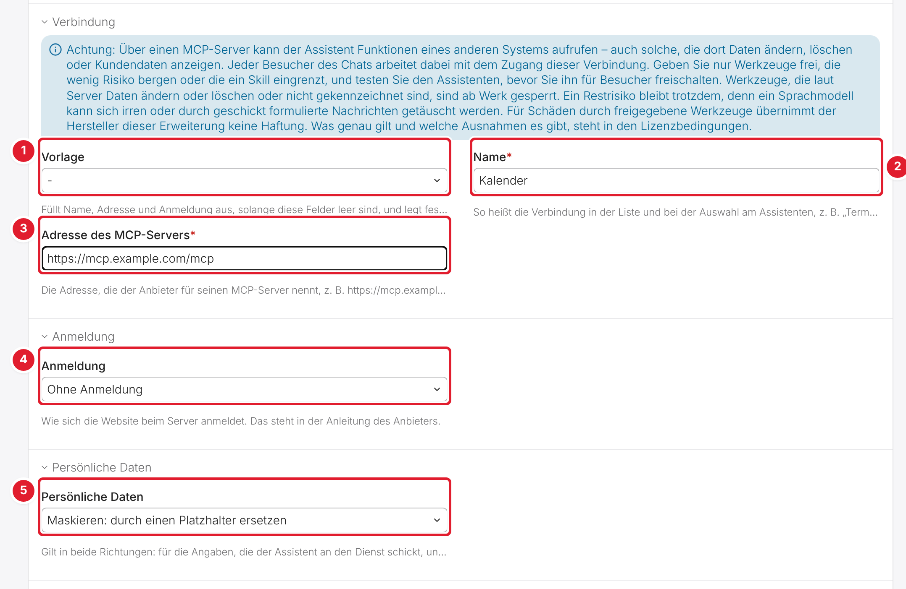
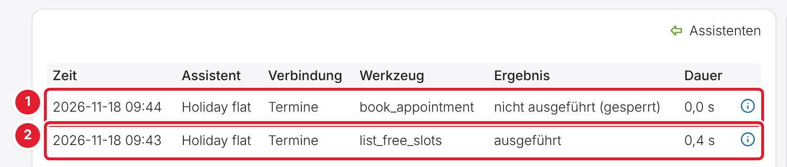

# Verbindungen zu MCP-Servern

Ein MCP-Server ist die Schnittstelle eines anderen Systems (ein Buchungs- oder
Terminsystem, ein Shop, ein CRM), über die ein KI-Assistent dessen Funktionen
aufrufen kann, die *Werkzeuge*. Administratoren verbinden solche Server;
Redakteure wählen dann am Assistenten, welche Werkzeuge er benutzen darf. Jeder
Besucher des Chats arbeitet mit dem Zugang der Verbindung; deshalb sperrt die
Erweiterung riskante Werkzeuge von selbst und verlangt eine Bestätigung.

Voraussetzungen: eine Lizenz für Plus oder Pro mit bestätigten Bedingungen; der
Benutzer ist Administrator. Erst dann erscheint die Schaltfläche
**Verbindungen** über der Liste der Assistenten.

## Eine Verbindung anlegen

1. Auf **Verbindungen** und dann auf **Neue Verbindung** klicken.
2. **Vorlage** (nur wenn es Vorlagen gibt, siehe [Vorlagen](#vorlagen)): füllt
   Name, Adresse und Anmeldung aus.
3. **Name**, z. B. „Terminbuchung“, und **Adresse des MCP-Servers**, z. B.
   `https://mcp.example.com/mcp`. Nur HTTPS und nur öffentliche Adressen.
4. **Anmeldung**:

   | Auswahl | Was einzutragen ist |
   | --- | --- |
   | **Ohne Anmeldung** | nichts |
   | **Schlüssel (Authorization: Bearer)** | **Schlüssel** |
   | **Eigene Header** | **Eigene Header**: Name und Wert je Zeile, z. B. `X-Api-Key` |
   | **OAuth (Anmeldung beim Dienst)** | Speichern, dann **Verbinden** (unten) |

5. **Persönliche Daten** (gilt in beide Richtungen: für das, was an den Dienst
   geht, und für die Ergebnisse, die an den KI-Dienst gehen):

   | Auswahl | Wirkung |
   | --- | --- |
   | **Maskieren: durch einen Platzhalter ersetzen** (Vorgabe) | E-Mail-Adressen, Telefonnummern, IBANs, Kartennummern, Sozialversicherungsnummern und Geburtsdaten werden ersetzt; ein Werkzeug, das Daten ändert, läuft damit nicht (es würde den Platzhalter speichern, z. B. als Kontakt einer Buchung) |
   | **Nicht senden: Aufruf oder Ergebnis zurückhalten** | Ein Aufruf oder Ergebnis, das sie enthält, wird zurückgehalten |
   | **Alles senden** | Alles wird weitergegeben |

   Namen und Anschriften werden nicht erkannt.
6. Speichern. Die Erweiterung liest die Werkzeuge des Servers (unten).

Im Bild: 1 **Vorlage**, 2 **Name**, 3 **Adresse des MCP-Servers**, 4
**Anmeldung**, 5 **Persönliche Daten**; darüber die Warnung, dass jeder
Besucher mit dem Zugang der Verbindung arbeitet.

Schlüssel, Werte der Header, Client-Secret und Tokens werden verschlüsselt
gespeichert und nie wieder angezeigt.

### OAuth

Nach dem Speichern auf **Verbinden** klicken. Die Erweiterung findet die
Anmeldung des Servers selbst (OAuth-Metadaten der MCP-Spezifikation),
registriert die Website automatisch, wo der Dienst das erlaubt, und leitet zur
Anmeldeseite des Dienstes; danach kommt man zurück. Tokens werden von selbst
erneuert.

Dienste ohne automatische Registrierung brauchen eine eigene App: beim Dienst
eine App anlegen, dort die Weiterleitungsadresse eintragen, die an der
Verbindung steht (Pfad `/contao/neo-superagent/oauth`), und **Client-ID (nur
bei eigener App)** und **Client-Secret (nur bei eigener App)** der App an der
Verbindung eintragen. Dann **Verbinden**. **Abmelden** entfernt die Anmeldung.

## Werkzeuge und Sperren

Nach dem Speichern liest die Erweiterung die Werkzeuge des Servers mit der Art,
die der Server angibt: *liest nur*, *ändert Daten*, *löscht Daten*, *nicht
gekennzeichnet*.

- Werkzeuge, die ändern, löschen oder nicht gekennzeichnet sind, sind beim
  ersten Auftauchen gesperrt. Ein gesperrtes Werkzeug kann kein Assistent
  benutzen.
- **Werkzeuge neu lesen** liest die Liste neu; neue Werkzeuge tragen **NEU**.
- **braucht persönliche Daten** steht bei einem Werkzeug mit einer Eingabe zu
  einer Person: E-Mail-Adresse, Telefonnummer, Vor- oder Nachname,
  Geburtsdatum, IBAN, oder ein Name bzw. eine Adresse, deren Beschreibung von
  einer Person spricht (Gast, Kunde, Benutzer …). Ein Ortsname oder eine
  Adresse allein zählt nicht; ein Wetter-Werkzeug, das nach einem Ort fragt,
  trägt die Markierung also nicht. Die Markierung ist ein Hinweis und sperrt
  nichts. Im Datenschutz-Modus entfernt der Server E-Mail-Adressen und
  Telefonnummern aus den Nachrichten der Besucher, und der Assistent fragt
  nicht nach persönlichen Daten; ein solches Werkzeug bekommt diese Angaben
  dann nicht.
- Das Aufheben einer Sperre und die erste Freigabe der Verbindung brauchen das
  Häkchen **Ich habe die freigegebenen Werkzeuge geprüft und verstehe das
  Restrisiko.** Gespeichert wird, wer es wann getan hat („Bestätigt von … am
  …“).

Im Bild: 1 **Werkzeuge neu lesen**, 2 ein Werkzeug, das nur liest, freigegeben
(das Kästchen **gesperrt** ist nicht angehakt), 3 ein Werkzeug, das Daten ändert,
beim ersten Auftauchen gesperrt, 4 der Vermerk **braucht persönliche Daten**, 5
die Bestätigung: wer wann bestätigt hat, und das Häkchen für die nächste
Änderung. Ein Werkzeug freigeben: **gesperrt** abhaken, das Häkchen der
Bestätigung setzen und speichern.

Die Liste der Verbindungen zeigt den Stand jeder, z. B. „aktiv · 4 von 6
Werkzeugen frei“, „Werkzeuge nicht gelesen“ oder „nicht bestätigt“.

## Werkzeuge am Assistenten wählen

Im Assistenten, Abschnitt **Werkzeuge der Verbindungen**, anhaken, was der
Assistent benutzen darf, je Verbindung. Ab Werk ist nichts angehakt; gesperrte
Werkzeuge erscheinen nicht. Hinweise unter der Liste sagen, wenn der
Datenschutz-Modus an ist und ein angehaktes Werkzeug „braucht persönliche
Daten“ trägt, oder wenn das Modell keine Werkzeuge aufrufen kann.

### Welches Sprachmodell

Werkzeuge von Verbindungen brauchen ein starkes Modell: Es plant mehrere
Schritte, übernimmt die Angaben aus dem Gespräch und ruft die Werkzeuge der
Reihe nach auf. Schwächere Modelle fragen erneut nach dem, was der Besucher
schon geschrieben hat, buchen vor seiner Zustimmung, lassen den Zahlungslink
weg oder geben auf. Unter der Liste der Werkzeuge und unter dem Feld **Modell**
sagt der Assistent, ob sein Modell zu den getesteten gehört.

Getestet am 15. November 2026 mit dem Buchungsablauf der Vorlage apaleo, je
zweimal, über die KI-Route Requesty EU (Angebote für Daten und Personen; die
Daten einmal erfragt; eine Zusammenfassung; einmal gebucht nach dem Ja des
Besuchers; der Zahlungslink eines Tarifs mit Vorauszahlung in derselben
Antwort; Adresse und Telefonnummer im richtigen Format eingetragen; die nächste
Frage ohne neue Abfrage beantwortet):

| Modell | Ergebnis |
| --- | --- |
| GPT-6 Luna, GPT-6 Sol, GPT-6.1 Sol, GPT-5.6 Luna, GPT-5.5 | alle Punkte, beide Läufe |
| Claude Sonnet 4.5, Mistral Large 4 | alle Punkte, beide Läufe |
| Claude Sonnet 5.5 | schickte die Buchung als Text statt als Objekt; nicht in der Liste |
| GPT-4.1, o4-mini, Claude Haiku 5.5 | einen Punkt verfehlt (Telefonformat, Adresse oder Zahlungslink) |
| GPT-5.1, GPT-4.1 mini, GPT-4o mini, Gemini 3.8 Flash | buchten vor der Zustimmung oder ohne Zahlungslink |

Bevor Besucher eine Verbindung mit einem anderen Modell nutzen, gehen Sie ihre
Abläufe selbst im Chat durch.

## Im Chat

Die Werkzeuge stehen im Katalog des Modells; es lädt und ruft sie selbst auf,
wenn eine Frage sie braucht. Ob ein Aufruf laufen darf (angehakt, Verbindung
bestätigt, nicht gesperrt), wird bei jedem Aufruf geprüft. Ein Aufruf darf bis
zu 20 Sekunden dauern; Ergebnisse über 20 000 Zeichen werden gekürzt, und das
Modell erfährt es. Während ein Werkzeug läuft, erscheint der Satz, den das
Modell zum Aufruf schreibt (z. B. „Einen Moment, ich prüfe die Termine.“),
sofort als eigene Nachricht; die Antwort folgt in der nächsten.

Eine Datei in einem Ergebnis (ein PDF, z. B. eine Rechnung) geht nicht an den
KI-Dienst: Der Besucher bekommt unter der Antwort einen Download-Knopf. Die
Datei liegt 15 Minuten bereit und lässt sich einmal herunterladen; danach zeigt
der Knopf *Heruntergeladen*, und der Link gibt einen Hinweis. Der Besucher kann
erneut danach fragen und bekommt einen neuen Link.

## Protokoll

Die Schaltfläche **Protokoll** über der Liste der Assistenten (Administratoren)
führt jeden Aufruf: Assistent, Verbindung, Werkzeug, Zeit, Dauer, Ergebnis
(**ausgeführt**, **Fehler des Servers**, **kein Ergebnis**, **nicht
ausgeführt**) und einen Hinweis (z. B. **gesperrt**, **Anmeldung abgelehnt**,
**Server nicht erreichbar**, **Ergebnis gekürzt**, **persönliche Daten
maskiert**, **vom KI-Dienst abgelehnt**). Argumente und Ergebnisse werden nicht
gespeichert. Einträge bleiben 30 Tage.

Im Bild: 1 ein Aufruf, der nicht lief, weil das Werkzeug gesperrt ist, 2 ein
Aufruf, der lief. Das Symbol am Ende einer Zeile zeigt den Eintrag.

**Vom KI-Dienst abgelehnt**: Der KI-Dienst hat die Beschreibung dieses
Werkzeugs (sein Eingabeschema) nicht angenommen. Der Chat lässt nur dieses
Werkzeug weg und arbeitet mit den übrigen weiter; mit diesem KI-Dienst ist das
Werkzeug nicht nutzbar.

## Netzwerk

Die Erweiterung erreicht nur öffentliche HTTPS-Adressen; private Netze sind
gesperrt, auch nach der Namensauflösung und nach Weiterleitungen. Auf einem
Server, der seinen ausgehenden Verkehr über einen Proxy in einem privaten Netz
schickt, sperrt das jeden MCP-Server; dieser Aufbau wird nicht unterstützt.

## Vorlagen

Eine Vorlage bereitet eine Verbindung zu einem bekannten Dienst vor: Sie füllt
Name, Adresse und Anmeldung aus, kann die OAuth-Endpunkte und Scopes festlegen
(mit einem Hinweis bei **Verbinden**, wenn der Dienst eine eigene App braucht,
und einem Link auf die Anleitung des Anbieters neben der Auswahl), sagt, welche
Werkzeuge nur lesen, welche Kundendaten zeigen (beim ersten Auftauchen
gesperrt, in der Liste markiert), welche empfohlen sind und welche frei sind,
obwohl sie etwas ändern (für Dienste, deren eigene Rechte entscheiden, z. B. die
einer App). Sie kann Skills mitbringen, die mit der Verbindung installiert
werden (Quelle *Vorlage*) und einen neuen Text der Vorlage selbst übernehmen
(Datenbank-Aktualisierung nach einem Update der Erweiterung oder Speichern der
Verbindung), im Formular die Schritte der Einrichtung beim Dienst
zeigen (mit der Weiterleitungsadresse zum Kopieren) und den Gast prüfen, bevor
die Werkzeuge eines Buchungssystems laufen (Gastprüfung).

Mitgeliefert: **apaleo** (siehe unten). Eigene Vorlagen kommen nach
`config/superagent/mcp-templates/<id>/` der Installation; eine Projektvorlage
mit der ID einer mitgelieferten ersetzt sie. Das Format beschreibt
[mcp-templates/README.md](../../../mcp-templates/README.md) des Pakets
(englisch).

## apaleo

Die Vorlage **apaleo** verbindet das Hotelsystem apaleo. Das Formular der
Verbindung zeigt die Schritte; kurz:

1. Speichern, dann **Verbinden**. Der MCP-Server von apaleo hat einen eigenen
   Anmeldedienst: Die Website meldet sich dort selbst an, eine eigene App ist
   nicht nötig (keine Store-App; Client-ID und Client-Secret bleiben leer). Mit
   einem apaleo-Benutzer Ihres Kontos anmelden und den Zugriff erlauben. Die
   Anmeldung fragt die Berechtigungen an, die die Werkzeuge der Vorlage
   brauchen: Betrieb und Einstellungen, Verfügbarkeit und Angebote lesen;
   Reservierungen lesen, anlegen und ändern; Folios lesen und ändern;
   Rechnungen lesen und erstellen. Der Assistent kann nur, was dieser Benutzer
   in apaleo darf.
2. **Personenbezogene Daten** auf **Senden** stellen: Eine Buchung braucht die
   E-Mail-Adresse und Telefonnummer des Besuchers.
3. Die Werkzeuge prüfen, sie und die sieben Skills der Vorlage am Assistenten
   anhaken und den KI-Dienst und apaleo in der Datenschutzerklärung nennen.

Verbindungen, die mit einer früheren Fassung der Vorlage angelegt wurden
(eigene App bei der Anmeldung zum apaleo-Konto), lehnt der MCP-Server ab
(„HTTP 401“). Client-ID und Client-Secret leeren, speichern und neu
**Verbinden**. Antworten Werkzeuge mit einem Fehler zu fehlenden
Berechtigungen, ebenfalls neu **Verbinden**, damit der Zugriff die
Berechtigungen oben umfasst.

Was der Assistent dann kann: Fragen zum Haus aus apaleo beantworten, Angebote
zeigen und buchen (mit einer Zusammenfassung, die der Besucher bestätigt), und
nach der Gastprüfung die Reservierung zeigen, Name und Kontakt berichtigen,
Leistungen dazubuchen, Daten ändern, mit der Gebühr der Richtlinie stornieren,
Zahlungslinks anlegen, Online-Zahlungen nach einer kostenlosen Stornierung
erstatten und Rechnungen zum Herunterladen geben. Bei einem Tarif mit
Vorauszahlung oder ohne kostenlose Stornierung kommt der Zahlungslink mit der
Bestätigung der Buchung, ohne weitere Frage; eine Buchung aus dem Chat braucht
keine Gastprüfung. Was der Besucher angibt, wird eingetragen: eine Adresse bei
Bucher und Gast samt Land (aus Postleitzahl und Ort, wenn der Besucher es
weglässt, z. B. 1010 Wien: Österreich), eine Telefonnummer im internationalen
Format ohne Leerzeichen (eine führende 0 wird zur Ländervorwahl, z. B. +43 für
Österreich); nur wenn das unklar ist, fragt der Assistent nach. Bezahlt wird nur auf der Seite eines
Zahlungslinks; der Chat fragt nie nach Kartendaten.

Die Gastprüfung: Bevor ein Werkzeug eine Reservierung zeigt oder ändert, nennt
der Besucher die Reservierungs- oder Buchungsnummer, den Namen und die
E-Mail-Adresse oder Telefonnummer, die für Gast oder Bucher gespeichert ist.
Der Server vergleicht sie; der KI-Dienst erfährt nur, ob sie passen. Der Gast
eines Zimmers sieht nur diese Reservierung, der Bucher die ganze Buchung. Eine
im Chat angelegte Buchung gilt als geprüft. Nach fünf Fehlversuchen ist die
Prüfung 24 Stunden gesperrt.

Beim ersten Auftauchen gesperrt: alles, was löscht, der Tagesabschluss,
Berichte, Exporte, Buchhaltung, Protokolle, Gästeprofile, Benutzer und jedes
Werkzeug, das etwas ändert und das die Vorlage nicht freigibt (Preise,
Einstellungen, Buchungen auf Folios, Check-in). Was der angemeldete
apaleo-Benutzer nicht darf, kann auch der Assistent nicht.
