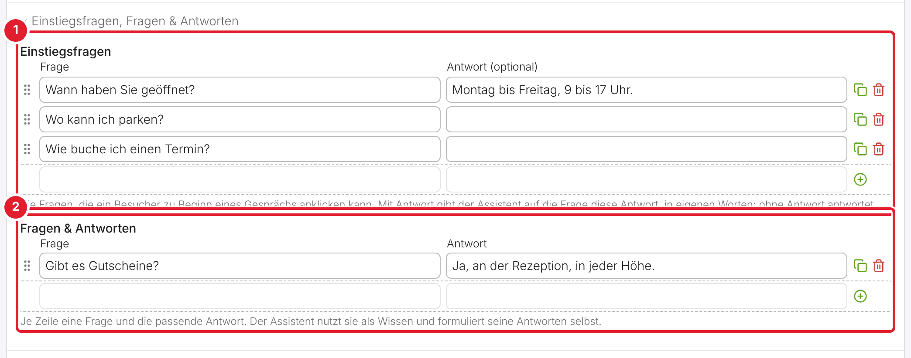

# Texte je Sprache

Jeder Assistent hat eine Sprache: einen Sprachdatensatz mit Begrüßung,
Einstiegsfragen und Texten. Eine Website mit mehreren Sprachen hat je Sprache
einen Assistenten (siehe unten).

## Die Sprachdatensätze öffnen

Den Assistenten öffnen (**NEO Digital › SuperAgent**, **Bearbeiten**). Der
Abschnitt **Sprachen und Einstiegsfragen** nennt jede Sprache mit ihren
Einstiegsfragen; **Texte und Einstiegsfragen bearbeiten** öffnet den Datensatz
einer Sprache, **Sprache hinzufügen** legt ihn an, solange der Assistent keinen hat.

Ein neuer Assistent bekommt einen Datensatz in der ersten Sprache der Website.
Hat eine Sprache der Website keinen veröffentlichten Assistenten, nennt die
Liste der Assistenten sie.

## Die Felder

| Abschnitt | Feld | Bedeutung |
| --- | --- | --- |
| Sprache | **Sprache** | Die Sprache des Datensatzes. Die Wahl füllt die leeren Felder mit Vorschlägen in dieser Sprache. |
| Texte | **Untertitel** | Kurzer Untertitel im Kopf des Chats |
| | **Begrüßung** | Erste Nachricht des Assistenten |
| | **Hinweistext** | Kleiner Hinweis, z. B. „nennt nur gesicherte Infos“ |
| | **Eingabe-Platzhalter** | Platzhalter im Nachrichtenfeld |
| Einstiegsfragen, Fragen & Antworten | **Einstiegsfragen** | Die Fragen, die ein Besucher zu Beginn eines Gesprächs anklicken kann, als Knöpfe unter der Begrüßung; je Zeile eine **Frage** und eine **Antwort (optional)** (siehe unten) |
| | **Fragen & Antworten** | Weiteres Wissen, nicht als Knopf gezeigt: je Zeile eine Frage und ihre Antwort. Der Assistent nutzt sie als Wissen und formuliert seine Antworten selbst. |
| Knöpfe & Hinweise des Widgets | jeder feste Text des Fensters | KI-Hinweis, Chat-Knopf, Knöpfe zum Öffnen und Schließen, Bitte um Einwilligung und der Hinweis, dass der Chat nicht verfügbar ist, Senden-Knopf, der Weiterleiten-Link und jeder Text des Weiterleiten-Formulars, die Bestätigung, die Fehlermeldung, der Datenschutzhinweis unter der Eingabe, „Seite öffnen“, „neues Gespräch“, die Statustexte, die Texte der Spracheingabe, der Knopf für die Einstiegsfragen |

Leere Felder nutzen die Vorgabe der Sprache, grau angezeigt.

Zwei Felder sind Vorgaben statt fester Texte; die Antwort formuliert der
Assistent selbst:

- **Datenschutz: Vorgabe für die Antwort**: was er sinngemäß sagt, wenn
  persönliche Daten aus einer Nachricht entfernt wurden;
- **Keine medizinischen Auskünfte: Vorgabe für die Antwort**: was er sagt, wenn
  er eine medizinische Frage ablehnt, z. B. die Notrufnummer.

Platzhalter: `%name%` steht für den Anzeigenamen des Assistenten, `%to%` für den
Namen auf dem Weiterleiten-Knopf, `%title%` für den Titel einer Seite (Knopf
„Seite öffnen“), `%time%` für die Dauer einer Aufnahme, `%email%` für die
vorgeschlagene Adresse beim Tippfehler-Hinweis.

## Einstiegsfragen

Ziel: Besucher sehen beim Öffnen des Chats ein paar Fragen zum Anklicken.

1. Den Assistenten öffnen und im Abschnitt **Sprachen und Einstiegsfragen** bei
   der Sprache auf **Texte und Einstiegsfragen bearbeiten** klicken.
2. Unter **Einstiegsfragen** je Zeile eine **Frage** eintragen. Die Knöpfe neben
   einer Zeile kopieren, verschieben oder löschen sie.
3. Wahlweise eine **Antwort (optional)** eintragen. Mit Antwort gibt der
   Assistent diese Antwort, wenn der Besucher die Frage anklickt oder sie mit
   anderen Worten stellt, in eigenen Worten. Ohne Antwort antwortet er aus
   seiner Wissensquelle wie auf jede andere Frage.
4. Auf **Speichern** klicken.

Im Bild: 1 **Einstiegsfragen**, 2 **Fragen & Antworten**.

Ergebnis: Der Chat zeigt die Fragen als Knöpfe unter der Begrüßung, bis der
Besucher eine davon stellt; der Knopf über der Eingabe zeigt sie wieder. Der
Abschnitt **Sprachen und Einstiegsfragen** des Assistenten nennt sie, mit der
Antwort, wo es eine gibt.

Jede Sprache hat eigene Einstiegsfragen; eine Sprache ohne zeigt keine.
**Fragen & Antworten** bleibt der Ort für weiteres Wissen, das nicht als Knopf
erscheint.

## Vorschläge laden

**Vorschläge laden** füllt leere Felder auch später mit den Vorschlägen der
Sprache. Eigene Texte werden nie überschrieben. Vorschläge gibt es für die elf
Sprachen der Erweiterung.

## Welchen Datensatz eine Seite bekommt

- Gewählt wird nach dem Hauptsprachcode der Seite (`de-AT` → `de`).
- Eine Seitensprache ohne Datensatz nutzt die Standardtexte dieser Sprache; eine
  Sprache außerhalb der elf (z. B. Thai) nutzt Englisch.
- Die Sprache der Seite ist die Standard-Antwortsprache; die Anweisungen an das
  Modell sind für jede Sprache gleich.
- Der Hinweis der Gratisfassung ist immer englisch und lässt sich nicht ändern.

## Mehrere Sprachen auf der Website

Jede Sprache bekommt einen eigenen Assistenten, mit eigenen Einstiegsfragen,
Texten und, wo nötig, eigenem Wissen und eigener Weiterleitungsadresse.

1. In der Liste der Assistenten beim Assistenten auf **Kopieren** klicken. Die
   Kopie übernimmt alle Einstellungen und den Sprachdatensatz.
2. In der Kopie den **Titel** ändern (etwa „Assistent Englisch“), ihren
   Sprachdatensatz öffnen, die **Sprache** ändern und Texte und Einstiegsfragen
   anpassen. Anpassen, was sonst abweicht: **Wissensquelle**, **Anzeigename**,
   **E-Mail für die Weiterleitung**.
3. Je Sprache ein Frontend-Modul **KI-Assistent (Chat-Widget)** anlegen und im
   Feld **Assistent** den Assistenten dieser Sprache wählen.
4. Jedes Modul in das Layout seiner Sprache setzen. Nutzen alle Sprachen dasselbe
   Layout, das Layout unter **Layout › Themes › Seitenlayouts** duplizieren, das
   Modul tauschen und das neue Layout dem Startpunkt der Sprache zuweisen.

Ergebnis: Jede Sprache hat ihren eigenen Assistenten. Ein Modul ohne gewählten
Assistenten zeigt den ersten aktiven; deshalb im Modul jeder Sprache den
Assistenten ausdrücklich wählen. Assistenten aus früheren Fassungen mit mehreren
Sprachdatensätzen funktionieren weiter; eine Seite bekommt den Datensatz ihrer
Sprache.
