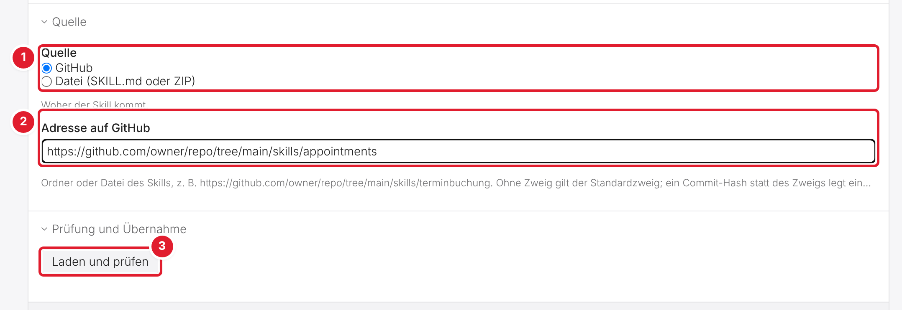
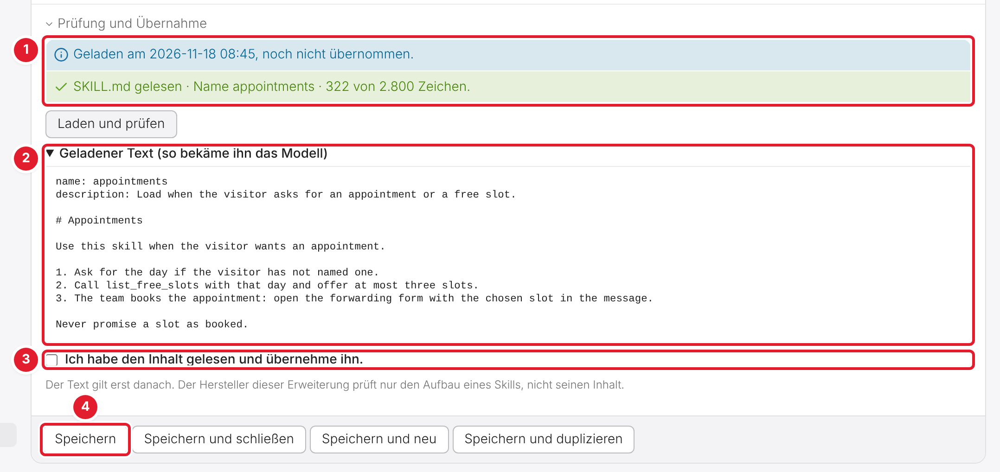

# Installierte Skills

Ein Skill ist ein kurzer Satz Regeln für das Modell in einem Bereich, z. B.
„Aufenthalte mit Haustieren“ oder „Identitätsnachweis, bevor eine Buchung
gezeigt wird“. Die Erweiterung bringt eigene Skills mit (Kern, Navigation,
Kontakt, Internetsuche, Vermittlung, Medizin, Datenschutz); Administratoren
ergänzen weitere mit der Schaltfläche **Skills** über der Liste der
Assistenten. Mitgelieferte Skills lassen sich nicht ändern, und installierte
Skills dürfen ihre Namen nicht tragen.

Voraussetzungen: eine Lizenz für Plus oder Pro mit bestätigten Bedingungen; der
Benutzer ist Administrator.

## Einen Skill installieren

1. Auf **Skills** und dann auf **Neuer Skill** klicken.
2. **Quelle**:
   - **GitHub**: **Adresse auf GitHub** des Skill-Ordners oder seiner
     `SKILL.md`, z. B.
     `https://github.com/owner/repo/tree/main/skills/terminbuchung`. Ohne Zweig
     gilt der Standardzweig; ein Commit-Hash statt des Zweigs legt eine Fassung
     fest. Nur öffentliche Repositorys.
   - **Datei (SKILL.md oder ZIP)**: eine `SKILL.md` oder eine ZIP-Datei mit
     einer `SKILL.md`, aus der Dateiverwaltung oder dort hochgeladen.
     ZIP-Dateien brauchen die PHP-Erweiterung `zip`.
3. Speichern. Die Erweiterung lädt und prüft den Skill („Geladen und geprüft.
   Lesen Sie den Text und übernehmen Sie ihn mit dem Häkchen unten.“).

Im Bild: 1 **Quelle**, 2 **Adresse auf GitHub**, 3 **Laden und prüfen**
(speichert und lädt den Skill).

## Die Prüfung

| Regel | Meldung, wenn sie nicht erfüllt ist |
| --- | --- |
| Am Anfang ein Kopf mit `name` und `description` zwischen zwei Zeilen `---` | „Am Anfang fehlt der Kopf mit name und description …“ |
| `name`: Kleinbuchstaben, Ziffern und Bindestriche, vorne ein Buchstabe, höchstens 64 Zeichen | „Der Name „…“ ist ungültig: …“ |
| `name` nicht von einem mitgelieferten oder anderen installierten Skill belegt | „Der Name „…“ ist schon vergeben …“ |
| `description` vorhanden (sie sagt dem Modell, wann es den Skill lädt), höchstens 300 Zeichen | „Die Beschreibung (description) fehlt. …“ / „Die Beschreibung hat … Zeichen, erlaubt sind höchstens ….“ |
| Der Text nicht leer, höchstens 2 800 Zeichen; längere Skills werden nicht verlässlich befolgt | „Der Text hat … Zeichen, erlaubt sind höchstens …. Teilen Sie ihn in mehrere kleinere Skills.“ |
| Abhängigkeiten (`depends:`) vorhanden | „Der Skill baut auf „…“ auf (depends), den es hier nicht gibt.“ |
| Werkzeuge, die der Skill nennt (`tools:`), gibt es in einer Verbindung | ein Hinweis, kein Fehler: „Das Werkzeug „…“ (tools) gibt es in keiner Verbindung. …“ |

Verwendet wird nur die `SKILL.md`: Andere Dateien einer ZIP werden genannt
(„Nicht übernommen (es zählt nur die SKILL.md, nichts wird ausgeführt): …“) und
übergangen. Ausgeführt wird nie etwas.

## Einen Skill übernehmen

Das Formular zeigt den ganzen Text so, wie ihn das Modell bekommt. Er gilt erst
nach dem Häkchen **Ich habe den Inhalt gelesen und übernehme ihn.** und dem
Speichern. Gespeichert wird, wer ihn wann übernommen hat („Übernommen: …, von …
am …“). Der Hersteller der Erweiterung prüft nur den Aufbau eines Skills, nicht
seinen Inhalt.

Im Bild: 1 das Ergebnis des Ladens und der Prüfung, 2 der Text, wie ihn das
Modell bekäme (ein Klick auf seine Überschrift klappt ihn zu), 3 das Häkchen, 4
**Speichern**.

## Updates

**Auf neue Fassung prüfen** lädt die Quelle neu. Ein geänderter Text erscheint
mit seinen Änderungen gegenüber der übernommenen Fassung und gilt erst nach
derselben Bestätigung; sonst „Keine neue Fassung: Der Text ist unverändert.“
Während der Chat läuft, wird nichts geladen.

GitHub wird nur aus dem Backend erreicht, wenn ein Administrator einen Skill
lädt (`raw.githubusercontent.com`, keine GitHub-API, keine Daten von
Besuchern).

## Skills am Assistenten wählen

Im Assistenten, Abschnitt **Installierte Skills**, anhaken, welche Skills er
benutzen darf; ab Werk ist nichts angehakt. Das Modell sieht sie in seinem
Katalog und lädt einen selbst, wenn eine Frage in seinen Bereich fällt; die
Werkzeuge, die der Skill nennt, kommen mit. Wird ein Skill umbenannt, müssen
Assistenten, die den alten Namen angehakt haben, ihn neu anhaken.
