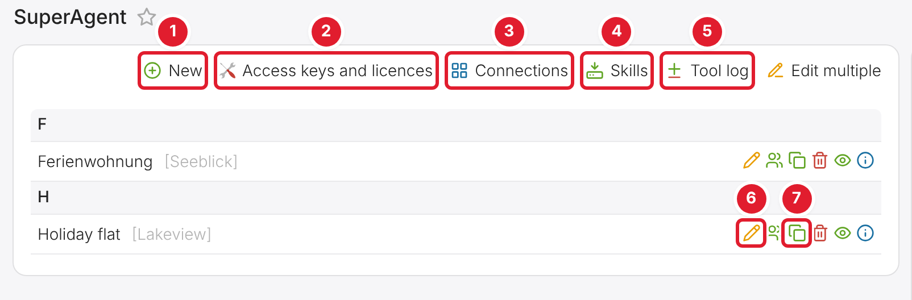
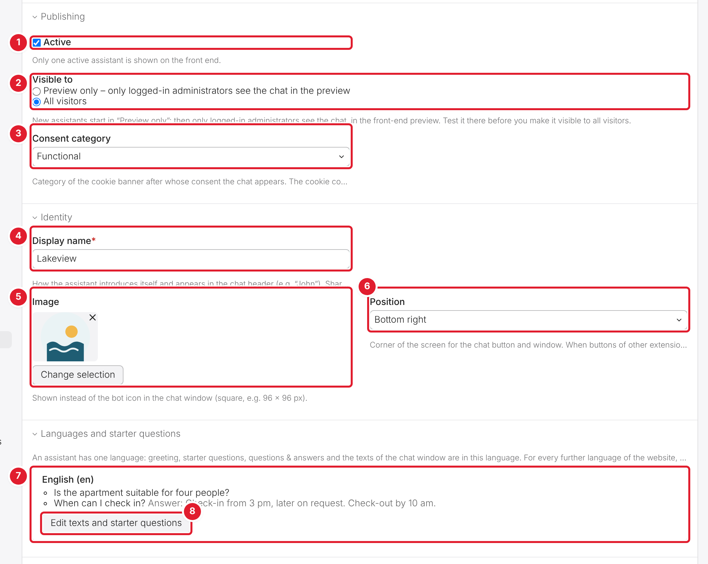
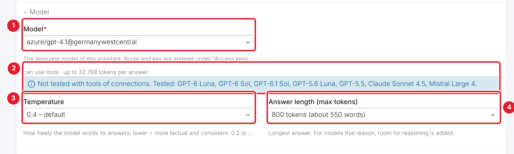
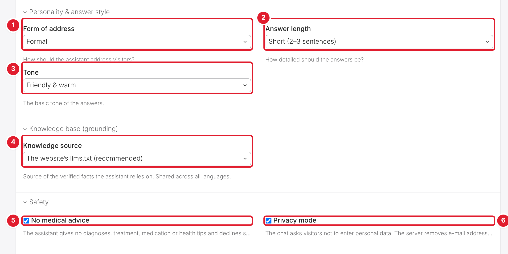
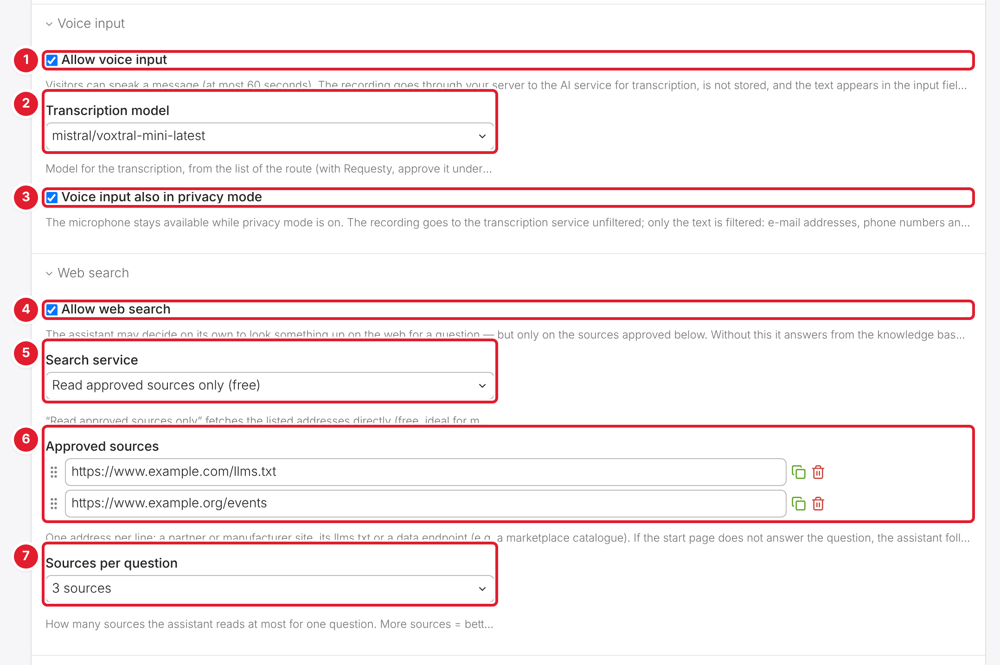

# Setting up an assistant

## Creating an assistant

1. Open **NEO Digital › SuperAgent** and click **New** (1 in the picture).
2. Fill in the sections below and save.
3. A new assistant gets a language record in the first language of the website,
   filled with suggestions. An assistant has one language; for each further
   language of the website, copy it (7) and change the language of the copy
   (see [Texts per language](languages.md#several-languages-on-the-website)).

In the picture: 1 **New**, 2 **Access keys and licences** (licence, AI
connection, terms; see [Setup](../setup.md)), 3 **Connections** and 4
**Skills** (Plus, administrators), 5 **Tool log** (administrators), 6 **Edit**
the assistant, 7 **Copy** it, e.g. for another language.

The list shows each assistant with its label and, in brackets, its display
name; an assistant in the preview carries the label *Preview*. Warnings above
the list name what is missing: no AI key, terms not confirmed, a website
language without its own texts ("No assistant has its own texts for … yet;
…", with **Create with suggestions for "…"**).

## The sections of the form

### General and publishing

| Field | Meaning |
| --- | --- |
| **Label** | Internal name in the back end |
| **Active** | Only active assistants are shown on the website |
| **Visible to** | **Preview only – only logged-in administrators see the chat in the preview** (preset for new assistants) or **All visitors**. *All visitors* can be chosen once the terms are confirmed. |
| **Consent category** | The category of the cookie banner after whose consent the chat appears: **No consent needed (chat available at once)**, **Functional**, **Statistics**, **Marketing** (see [Setup](../setup.md#6-consent-tool)). With NEO Cookie Consent and no active service in the category, the field says so in red, with the link **Add the service now** |

### Identity

| Field | Meaning |
| --- | --- |
| **Display name** | How the assistant introduces itself and appears in the header, e.g. "Mia" |
| **Image** | Shown instead of the bot icon (square, e.g. 96 × 96 px); any image from the file manager, also from protected folders |
| **Position** | **Bottom right** or **Bottom left** for chat button and window. When buttons of other extensions sit in the same corner (cookie settings, accessibility), they are arranged together as set in the page layout: one settings button with a menu, stacked or side by side ([The chat](chat.md#window)). |

### Languages and starter questions

Shows the language of the assistant with its starter questions (and their
answer, where there is one), read only. **Edit texts and starter questions**
opens the language record, with greeting, starter questions, questions &
answers and the texts of the window. **Add language** appears only while the
assistant has no language record. Details:
[Texts per language](languages.md#starter-questions).

In the picture: 1 **Active**, 2 **Visible to**, 3 **Consent category**, 4
**Display name**, 5 **Image** (**Change selection** opens the file manager),
6 **Position**, 7 the language with its starter questions (an answer follows
the question in grey), 8 **Edit texts and starter questions**.

### Model

| Field | Meaning |
| --- | --- |
| **Model** | The language model, from the live list of the route. If the list cannot be loaded, the field stays a text field. Below it the back end shows what the model can do: "can reason", "can use tools", "up to … tokens per answer". |
| **Reasoning effort** | Only for models that reason: **Off**, **Low (recommended)**, **Medium**, **High**. More reasoning is more accurate, slower and more expensive. |
| **Temperature** | Only for models that do not reason: how freely the model words its answers; 0.2 to 0.5 suits a chat (preset 0.4) |
| **Answer length (max tokens)** | 300, 500, 800 (preset), 1,200, 2,000 or 4,000 tokens; room for reasoning is added on top |

A model that cannot use tools shows: "This model cannot use tools. Web search
does not work with it; navigation and forwarding work through marker lines."

In the picture: 1 **Model**, 2 what the model can do and whether it is one of
the models tested with tools of connections, 3 **Temperature** (for models that
reason: **Reasoning effort**), 4 **Answer length (max tokens)**.

### Personality & answer style

| Field | Choices |
| --- | --- |
| **Form of address** | **Formal**, **Informal (first-name basis)** |
| **Answer length** | **Short (2–3 sentences)**, **Medium (4–6 sentences)**, **Detailed (with a list when it helps)** |
| **Tone** | **Professional & factual**, **Friendly & warm**, **Technical & precise** |

### Knowledge base

**Knowledge source**:

| Choice | What the assistant knows |
| --- | --- |
| **The website’s llms.txt (recommended)** | `llms-full.txt` of the web root, otherwise `llms.txt` (e.g. written by the extension NEO LLMS) |
| **llms.txt + additional text of your own** | the same, plus the **Knowledge text** |
| **Text (entered)** | the **Knowledge text** |
| **File from the file manager** | the **Knowledge file** (`txt`, `md`, `markdown`, `json`) |
| **None** | only the questions & answers of the language records |

The questions & answers of the language record are knowledge for the model as
well. Every reply comes from the model; when the AI service cannot be reached,
the window shows its error notice instead of a stored answer.

### Safety

| Field | Preset | Meaning |
| --- | --- | --- |
| **No medical advice** | on | The assistant declines questions about diagnoses, treatment, medication or health tips in its own words, following the guidance in the language record (e.g. the emergency number). |
| **Privacy mode** | on | The chat asks visitors not to enter personal data. The server removes e-mail addresses, phone numbers, IBANs, card numbers, Austrian social security numbers and dates of birth before anything goes to the AI service, also from earlier messages; the browser keeps only the cleaned version. Health information and other data that cannot be told by its form is left to a rule for the model. A place, a country or an address without a person's name is no personal data (e.g. a question about the weather). Functions that need personal data (e.g. a booking) are then not possible. |

A rule for a language model cannot rule out every slip.

In the picture: 1 **Form of address**, 2 **Answer length**, 3 **Tone**, 4
**Knowledge source**, 5 **No medical advice**, 6 **Privacy mode**.

### Voice input (Pro)

| Field | Meaning |
| --- | --- |
| **Allow voice input** | A microphone button next to the input; visitors speak at most 60 seconds |
| **Transcription model** | From the list of transcription models approved at the route (preset `mistral/voxtral-mini-latest`). With Requesty, approve a model under *Transcriptions* first; models of Mistral (Voxtral) and Scaleway process in the EU. |
| **Voice input also in privacy mode** | While privacy mode is on, there is no voice input, and both fields above are greyed out with the reason. This switch allows it anyway: the recording goes to the transcription service unfiltered; only the text is filtered. |

### Web search (Basic)

| Field | Meaning |
| --- | --- |
| **Allow web search** | The assistant may look something up on the web, only on the approved sources |
| **Search service** | **Read approved sources only (free)**: the listed addresses are read directly. **Search via SerpAPI — limited to the approved domains**: a search engine finds pages, only on the approved domains; needs the SerpAPI key (the status line says whether it is stored). |
| **Approved sources** | One address per line: a partner or manufacturer website, its `llms.txt`, a data endpoint. If the start page does not answer, the assistant follows matching sub-pages. |
| **Sources per question** | 1 to 5 (preset 3) |

The fields that belong to a switch appear as soon as it is ticked (the form reloads).

In the picture: 1 **Allow voice input**, 2 **Transcription model**, 3 **Voice
input also in privacy mode**, 4 **Allow web search**, 5 **Search service**, 6
**Approved sources** (one address per row; the buttons next to a row copy or
delete it), 7 **Sources per question**.

### Referral

| Field | Meaning |
| --- | --- |
| **Always refer to** | For setup, implementation, integration, migration, support and purchase the assistant refers to this provider, never to the maker of a third-party solution |
| **Preferred own solution** | Named first when it fits the question; empty = no preference |
| **What the solution is for** | One or two sentences, so the assistant mentions it only when it fits |

### Escalation & consent (Basic)

| Field | Meaning |
| --- | --- |
| **Escalation email** | Address forwarded requests go to. Empty: the assistant offers no forwarding and points to the contact options of the website. |
| **Forward to (name)** | Shown on the chat buttons, e.g. "Forward to John". Empty: "the team". |
| **Contact page** | The assistant can open this page when a visitor wants to reach a person, besides the form |
| **Additional fields in the form** | **Name**, **Phone**, **Company**. E-mail address and message are always in the form and required. |
| **Of these, required** | Only fields chosen on the left |
| **Preselected country code** | For the phone field; empty = by the language of the page |
| **Ask for consent to be contacted** | A required checkbox in the form (on for new assistants); the mail to the team notes the consent |
| **Privacy policy** | The page the checkbox links to; empty = no link |
| **Newsletter checkbox** | **Off**, or a newsletter module of the website: a module of the Brevo extension, or Contao's module *Subscribe* (only what is installed is offered). Its lists or channels and its confirmation e-mail apply. |

Without an escalation address, the form fields are greyed out: "Only used with
an escalation e-mail address above: without one, the chat has no forwarding
form." Problems of the chosen newsletter module are named at the field, e.g.
"The chosen module "Subscribe" is not on any published page. …"; until they are
solved the form shows no newsletter checkbox.

In the picture: 1 **Escalation email**, 2 **Forward to (name)**, 3 **Contact
page** and 8 **Privacy policy** (**Change selection** opens the page tree), 4
**Additional fields in the form**, 5 **Of these, required**, 6 **Preselected
country code**, 7 **Ask for consent to be contacted**, 9 **Newsletter
checkbox**. What visitors see of it: [The chat](chat.md#forwarding-to-the-team-basic).

### Installed skills and tools (Plus)

- **Skills**: which installed skills the assistant may use; nothing is ticked
  by default ([Installed skills](skills.md)).
- **Tools**: which tools of the connections the assistant may use, per
  connection; nothing is ticked by default, locked tools are not offered
  ([Connections to MCP servers](connections.md)). Notes below the list say
  when privacy mode is on and a ticked tool asks for a person's data, when the model
  cannot call tools, and how many ticked tools are not usable.

In the picture: 1 **Skills**, 2 **Tools**, grouped by connection (a click on
the name of a connection shows or hides its tools), 3 the note on the language
model (see [Which language model](connections.md#which-language-model)).

### Expert settings

**System prompt**: own instructions for the model, only for special cases;
form of address, length and tone are set above. `{name}` stands for the
display name.

## Testing in the preview

1. Leave **Visible to** on **Preview only** and **Active** on.
2. Log in to the back end as an administrator and open the website through
   Contao's **Preview**.
3. Open the chat, ask questions, try forwarding and navigation.

Visitors do not see an assistant in the preview, and the chat endpoints treat
it as absent for them.

## Making it visible

1. Confirm the terms on *Access keys and licences* (see
   [Setup](../setup.md#3-terms)).
2. Set **Visible to** to **All visitors** and save.
