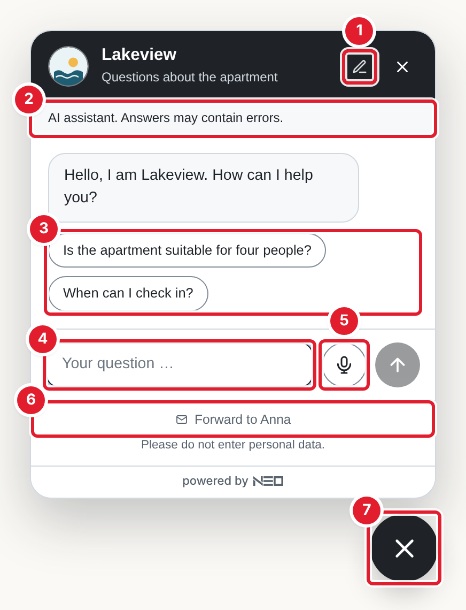

# The chat on the website

## Window

A round button opens the window in the chosen corner. When buttons of other
extensions share that corner (the button to reopen the cookie settings, the
button of an accessibility panel), the buttons at the edge of the screen of
NEO Basic arrange them as set in the page layout (**Buttons at the edge of
the screen**): with *One settings button with a menu* (the default) the chat
button gives way to a settings button with a cogwheel, and the entry with the
label of the chat button (e.g. "Nova — open chat") opens the window above the
settings button; stacked or side by side the chat button stays, nearest the
corner. When the window closes, the focus goes back to where it was when the
window opened (the settings button, or the chat button).

The window has:

- the header with image or bot icon, display name, subtitle, **New
  conversation** and the close button;
- below the header the AI notice, always: visitors are told that they write
  with an AI (EU AI Act, Article 50);
- the greeting and the starter questions as buttons. They stay below the
  greeting until the visitor asks one of them, also in the conversation
  restored on the next page; the button **Suggestions** above the input shows
  them again at any time;
- the input field with the send button; with privacy mode, the privacy note
  below it;
- without a licence, the credit line at the bottom.

In the picture: 1 the AI notice, 2 the starter questions, 3 the button
**Suggestions**.

While the assistant works, the answer bubble says what it is doing:
"Thinking …", "Looking for the right page …", "Preparing the form …",
"Searching the web …". The model's own reasoning is never shown.

With a consent category and without consent yet, the window first asks for
consent; its button opens the settings of the consent tool. When the consent
tool never asks for that category (no service in it), the window says instead:
"The chat is not available at the moment: the cookie settings of this website
do not include it yet."

## Navigation (Basic)

The assistant knows the pages of the website: regular pages below the root
page of the current page that are published, not protected and not set to
`noindex`, up to 300 pages, refreshed every ten minutes. Pages hidden in the
navigation (such as the legal notice) are included. When a visitor clearly
wants to go somewhere ("take me to the contact page"), the page opens at once;
otherwise the reply ends with the button **Open page: …**. Only pages of this
list can be opened, and only on the same host.

Without Basic the assistant opens no page and links a page of the website only
with an address that is in its knowledge (the knowledge source and the
questions & answers, e.g. the page list of an `llms.txt`); a link to any other
page of the website is shown as plain text. Links to other websites, e-mail
addresses and phone numbers stay.

## Forwarding to the team (Basic)

When a visitor wants to reach a person, the assistant opens the forwarding form
in the chat, prefilled with a summary. The visitor adds the e-mail address and
sends it; the assistant cannot send anything itself and never claims to have
forwarded something. It can also open the contact page set in the assistant.

The form has e-mail address and message (always required) and the fields chosen
in the assistant:

- **Phone**: the country code is a select box with a filter (search by name,
  ISO code or calling code), preselected per assistant or by the page
  language. The field takes digits and separators only. The national trunk
  prefix (usually the leading 0; not in Italy, San Marino and the Vatican) is
  dropped, a typed `+41 …` or `0041 …` selects the country, and the number is
  sent and mailed in E.164 form (`+436641234567`); the server checks it again.
- **E-mail address**: checked for its form and, on the server, for a domain
  that can receive mail (MX, A or AAAA record). Typos of well-known providers
  get a hint ("Did you mean …@gmail.com?").
- **Consent to be contacted**: a required checkbox with the link to the
  privacy policy.
- **Newsletter**: never preselected. The sign-up needs the confirmation by
  e-mail (double opt-in) and never blocks the forwarding.

Name, phone, company, consent and newsletter go only to the team by e-mail (and
the newsletter address to the newsletter service), never to the AI.

Without an escalation address, the assistant offers no forwarding and points to
the contact options of the website.

## Voice input (Pro)

A microphone button next to the input. The visitor speaks, at most 60 seconds;
the recording goes through the server of the website to the transcription
model of the AI service, and the text appears in the input field, where the
visitor checks it and sends it. Nothing is stored. While recording, the input
row shows the stop button, a level wave and the time; after stopping,
"Converting to text …" until the text is back.

With privacy mode on there is voice input only with **Voice input also in
privacy mode**. The recording then still reaches the transcription service
unfiltered; the text is filtered like a typed message (e-mail addresses, phone
numbers and the like become a marker) before it appears in the input field and
before anything reaches the chat model.

## Conversation across pages

The chat stays open when the visitor changes pages and continues where it was.
The conversation is kept in the browser tab only (`sessionStorage`) and is gone
when the tab is closed; **New conversation** clears it. Without consent nothing
is kept.

## Privacy mode in the chat

With privacy mode on, the chat asks visitors not to enter personal data. If a
message contains an e-mail address, a phone number or a similar identifier, the
server removes it before anything goes to the AI service, and the assistant
says so in its own words. The browser then keeps the cleaned message.
