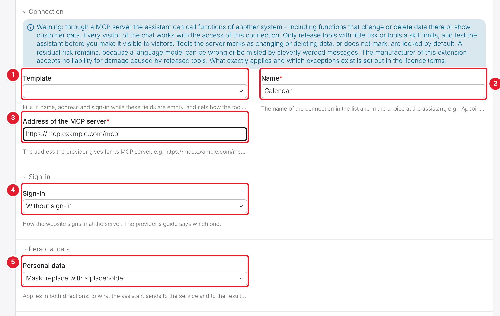
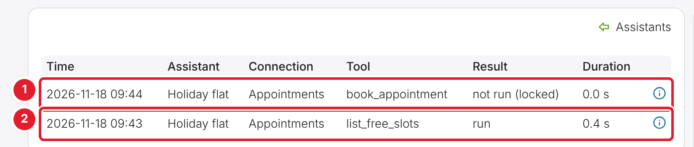

# Connections to MCP servers

An MCP server is the interface of another system (a booking or appointment
system, a shop, a CRM) through which an AI assistant can call its functions,
the *tools*. Administrators connect such servers; editors then choose at an
assistant which tools it may use. Every visitor of the chat works with the
access of the connection, so the extension locks risky tools by default and
asks for a confirmation.

Prerequisites: a licence for Plus or Pro, its terms confirmed; the user is an
administrator. The button **Connections** above the list of assistants appears
only then.

## Creating a connection

1. Click **Connections** and then **New connection**.
2. **Template** (only when there are templates, see [Templates](#templates)):
   fills in name, address and sign-in.
3. **Name**, e.g. "Appointments", and **Address of the MCP server**, e.g.
   `https://mcp.example.com/mcp`. HTTPS and public addresses only.
4. **Sign-in**:

   | Choice | What to enter |
   | --- | --- |
   | **Without sign-in** | nothing |
   | **Key (Authorization: Bearer)** | **Key** |
   | **Own headers** | **Own headers**: name and value per row, e.g. `X-Api-Key` |
   | **OAuth (sign in at the service)** | Save, then **Connect** (below) |

5. **Personal data** (applies in both directions: to what goes to the service
   and to the results that go to the AI service):

   | Choice | Effect |
   | --- | --- |
   | **Mask: replace with a placeholder** (preset) | E-mail addresses, phone numbers, IBANs, card numbers, social security numbers and dates of birth are replaced; a tool that changes data does not run with them (it would store the placeholder, e.g. as the contact of a booking) |
   | **Do not send: hold back the call or the result** | A call or a result that contains them is held back |
   | **Send everything** | Everything is passed on |

   Names and postal addresses are not recognised.
6. Save. The extension reads the tools of the server (below).

In the picture: 1 **Template**, 2 **Name**, 3 **Address of the MCP server**, 4
**Sign-in**, 5 **Personal data**; above them the warning that every visitor
works with the access of the connection.

Keys, header values, client secret and tokens are stored encrypted and never
shown again.

### OAuth

After saving, click **Connect**. The extension finds the sign-in of the server
itself (OAuth metadata of the MCP specification), registers the website
automatically where the service allows it, and sends you to the sign-in page
of the service; afterwards you come back. Tokens are refreshed automatically.

Services without automatic registration need an app of their own: create an app
at the service, enter there the redirect address shown at the connection (path
`/contao/neo-superagent/oauth`), and enter the **Client ID (own app only)** and
**Client secret (own app only)** of the app at the connection. Then
**Connect**. **Sign out** removes the sign-in.

## Tools and locks

After saving, the extension reads the tools of the server with the kind the
server states: *reads only*, *changes data*, *deletes data*, *not marked*.

- Tools that change, delete or are not marked are locked when they first
  appear. No assistant can use a locked tool.
- **Read tools again** reads the list again; new tools are marked **NEW**.
- **needs personal data** marks a tool with an input for a person: an e-mail
  address, a phone number, a first or last name, a date of birth, an IBAN, or
  a name or address whose description speaks of a person (guest, customer,
  user …). The name of a place or an address alone does not count, so a
  weather tool asking for a town is not marked. The marking is a hint and
  locks nothing. In privacy mode the server removes e-mail addresses and phone
  numbers from the visitor's messages and the assistant asks for no personal
  data, so such a tool does not get these details.
- Lifting a lock and the first release of the connection need the checkbox **I
  have checked the released tools and understand the residual risk.** Who did
  it and when is kept ("Confirmed by … on …").

In the picture: 1 **Read tools again**, 2 a tool that only reads, released
(the box **locked** is not ticked), 3 a tool that changes data, locked as it
first appeared, 4 the note **needs personal data**, 5 the confirmation: who
confirmed and when, and the checkbox for the next change. To release a tool,
untick **locked**, tick the checkbox of the confirmation and save.

The list of connections shows the state of each, e.g. "active · 4 of 6 tools
released", "tools not read" or "not confirmed".

## Choosing tools at the assistant

In the assistant, section **Tools of the connections**, tick what the assistant
may use, per connection. Nothing is ticked by default; locked tools are not
offered. Notes below the list say when privacy mode is on and a ticked tool is
marked "needs personal data", or when the model cannot call tools.

### Which language model

Tools of connections need a strong model: it plans several steps, takes the
details from the conversation and calls the tools one after another. Weaker
models ask again for what the visitor already wrote, book before the visitor
agreed, leave out the payment link or give up. Below the list of tools and
below the field **Model** the assistant says whether its model is one of the
tested ones.

Tested on 15 November 2026 with the booking flow of the apaleo template, twice
each, through the AI route Requesty EU (offers for dates and persons; the data
asked for once; one summary; booking once after the visitor's yes; the payment
link of a prepaid rate in the same reply; address and phone number entered in
the right format; the next question answered without a new look-up):

| Model | Result |
| --- | --- |
| GPT-6 Luna, GPT-6 Sol, GPT-6.1 Sol, GPT-5.6 Luna, GPT-5.5 | all points, both runs |
| Claude Sonnet 4.5, Mistral Large 4 | all points, both runs |
| Claude Sonnet 5.5 | sent the booking as a text instead of an object; not listed |
| GPT-4.1, o4-mini, Claude Haiku 5.5 | one point missed (phone format, address or payment link) |
| GPT-5.1, GPT-4.1 mini, GPT-4o mini, Gemini 3.8 Flash | booked before the visitor agreed or without the payment link |

Before visitors use a connection with another model, go through its flows in
the chat yourself.

## In the chat

The tools appear in the catalogue of the model; it loads and calls them itself
when a question needs them. Whether a call may run (ticked, connection
confirmed, not locked) is checked on every call. A call may take up to 20
seconds; results longer than 20,000 characters are cut and the model is told
so. While a tool runs, the sentence the model writes with the call (e.g. "One
moment, I am checking the dates.") appears at once as its own message; the
answer follows in the next one.

A file in a result (a PDF, e.g. an invoice) does not go to the AI service: the
visitor gets a download button below the reply. The file is kept 15 minutes
and can be downloaded once; then the button shows *Downloaded* and the link
gives a notice. The visitor can ask again for a new link.

## Tool log

The button **Tool log** above the list of assistants (administrators) lists
every call: assistant, connection, tool, time, duration, result (**run**,
**error of the server**, **no result**, **not run**) and a note (e.g.
**locked**, **sign-in refused**, **server not reachable**, **result cut**,
**personal data masked**, **refused by the AI service**). Arguments and
results are not kept. Entries are kept 30 days.

In the picture: 1 a call that did not run because the tool is locked, 2 a call
that ran. The icon at the end of a row shows the entry.

**Refused by the AI service**: the AI service did not accept the description
of this tool (its input schema). The chat leaves only this tool out and goes
on with the others; the tool cannot be used with this AI service.

## Network

The extension reaches only public HTTPS addresses; private networks are
blocked, also after DNS resolution and redirects. On a server that sends its
outgoing traffic through a proxy in a private network this blocks every MCP
server; that setup is not supported.

## Templates

A template prepares a connection to a known service: it fills in name,
address and sign-in, can fix the OAuth endpoints and scopes (with a note at
**Connect** when the service needs an app of your own, and a link to the
provider's guide next to the choice), says which tools only read, which show
customer data (locked when they first appear, marked in the list), which are
recommended and which are free although they change something (for services
whose own permissions decide, e.g. those of an app). It can bring skills that
are installed with the connection (source *Template*) and take over a new
text of the template by themselves (database update after an update of the
extension, or saving the connection), show the steps of the
setup at the service in the form (with the redirect address to copy), and
check the guest before the tools of a booking system run (guest check).

Shipped: **apaleo** (see below). Own templates go into
`config/superagent/mcp-templates/<id>/` of the installation; a project template
with the id of a shipped one replaces it. The format is described in
[mcp-templates/README.md](../../../mcp-templates/README.md) of the package.

## apaleo

The template **apaleo** connects the hotel system apaleo. The form of the
connection shows the steps; in short:

1. Save, then **Connect**. apaleo's MCP server has its own sign-in: the
   website registers itself there, so no app of your own is needed (no store
   app; client ID and client secret stay empty). Sign in with an apaleo user
   of your account and allow the access. The sign-in asks for the permissions
   the tools of the template need: read the property and its settings,
   availability and offers; read, create and change reservations; read and
   change folios; read and create invoices. The assistant can only do what
   this user may do in apaleo.
2. Set **Personal data** to **Send**: a booking needs the visitor's e-mail
   address and phone number.
3. Check the tools, tick them and the seven skills of the template at the
   assistant, and name the AI service and apaleo in the privacy policy.

Connections made with an earlier version of the template (own app at the
apaleo account login) are refused by the MCP server ("HTTP 401"). Empty
client ID and client secret, save and **Connect** again. Tools that answer
with an error about missing permissions also need **Connect** again, so that
the access covers the permissions above.

What the assistant can then do: answer questions about the hotel from apaleo,
show offers and book (with a summary the visitor confirms), and, after the
guest check, show the reservation, correct name and contact, add extras, change
dates, cancel with the fee of the policy, create payment links, refund online
payments after a free cancellation and deliver invoices as a download. With a
prepaid or non-refundable rate the payment link comes with the confirmation of
the booking, without a further question; a booking made in the chat needs no
guest check. What the visitor gives is entered: an address goes into booker and
guest with its country (taken from postal code and city when the visitor leaves
it out, e.g. 1010 Vienna: Austria), a phone number in international format
without spaces (a leading 0 becomes the country code, e.g. +43 for Austria);
only when that is unclear does the assistant ask. Payment happens only on the page of a payment
link; the chat never asks for card data.

The guest check: before a tool shows or changes a reservation, the visitor
gives the reservation or booking number, the name and the e-mail address or
phone number stored for the guest or booker. The server compares them; the AI
service only learns whether they match. The guest of a room sees only that
reservation, the booker the whole booking. A booking made in the chat counts as
verified. Five failed attempts lock the check for 24 hours.

Locked when they first appear: everything that deletes, the night audit,
reports, exports, accounting, logs, guest profiles, users and every tool that
changes something the template does not free (rates, settings, folio charges,
check-in). What the signed-in apaleo user may not do, the assistant cannot do either.
