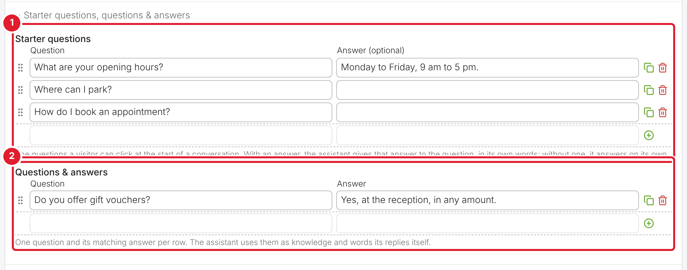

# Texts per language

Each assistant has one language: one language record with its greeting, starter
questions and texts. A website with several languages has an assistant for each
language (see below).

## Opening the language records

Open the assistant (**NEO Digital › SuperAgent**, **Edit**). The section
**Languages and starter questions** lists each language with its starter
questions; **Edit texts and starter questions** opens the record of a language,
**Add language** creates it while the assistant has none.

A new assistant gets a record in the first language of the website. When a
website language has no published assistant, the list of assistants names it.

## The fields

| Section | Field | Meaning |
| --- | --- | --- |
| Language | **Language** | The language of the record. Choosing it fills the empty fields with suggestions in that language. |
| Copy | **Subtitle** | Small line in the chat header |
| | **Greeting** | First message of the assistant |
| | **Safety note** | Small note, e.g. "only states verified information" |
| | **Input placeholder** | Placeholder in the message field |
| Starter questions, questions & answers | **Starter questions** | The questions a visitor can click at the start of a conversation, as buttons below the greeting; per row a **Question** and an **Answer (optional)** (see below) |
| | **Questions & answers** | Further knowledge, not shown as buttons: one question and its answer per row. The assistant uses them as knowledge and words its replies itself. |
| Buttons & notes of the widget | every fixed text of the window | AI notice, chat button, open and close buttons, consent request and the note that the chat is not available, send button, the forward link and every text of the forwarding form, the confirmation, the error message, the privacy note below the input, "Open page", "New conversation", the status texts, the texts of voice input, the button for the starter questions |

Empty fields use the default of the language, shown in grey.

Two fields are guidance rather than fixed text; the assistant words the reply
itself:

- **Privacy: guidance for the reply**: what it says in substance when personal
  data was removed from a message;
- **No medical advice: guidance for the reply**: what it says when it declines
  a medical question, e.g. the emergency number.

Placeholders: `%name%` stands for the display name of the assistant, `%to%`
for the name on the forward button, `%title%` for the title of a page (button
"Open page"), `%time%` for the length of a recording, `%email%` for the
suggested address of the typo hint.

## Starter questions

Goal: visitors see a few questions to click when they open the chat.

1. Open the assistant and click **Edit texts and starter questions** at the
   language in the section **Languages and starter questions**.
2. Under **Starter questions**, enter one **Question** per row. The buttons
   next to a row copy, move or delete it.
3. Optionally enter an **Answer (optional)**. With an answer, the assistant
   gives that answer when the visitor clicks the question or asks it in other
   words, in its own words. Without one, it answers from its knowledge source
   like any other question.
4. Click **Save**.

In the picture: 1 **Starter questions**, 2 **Questions & answers**.

Result: the chat shows the questions as buttons below the greeting, until the
visitor asks one of them; the button above the input shows them again. The
section **Languages and starter questions** of the assistant lists them, with
the answer where there is one.

Each language has its own starter questions; a language without any shows
none. **Questions & answers** stays the place for further knowledge that is not
shown as buttons.

## Loading suggestions

**Load suggestions** fills empty fields with the suggestions of the language
later as well. Own texts are never overwritten. Suggestions exist for the
eleven languages of the extension.

## Which record a page gets

- The record is chosen by the primary language code of the page (`de-AT` →
  `de`).
- A page language without a record uses the default texts of that language; a
  language outside the eleven (e.g. Thai) uses English.
- The page language is the default answer language; the instructions to the
  model are the same for every language.
- The credit line of the free edition is always English and cannot be changed.

## Several languages on the website

Each language gets an assistant of its own, with its own starter questions,
texts and, where needed, its own knowledge and forwarding address.

1. In the list of assistants, click **Copy** at the assistant. The copy takes
   all settings and the language record.
2. In the copy, change the **Label** (e.g. "Assistant English"), open its
   language record, change the **Language** and adjust the texts and starter
   questions. Adjust what else differs: **Knowledge source**, **Display name**,
   **Escalation email**.
3. Create one front end module **AI assistant (chat widget)** per language and
   choose the assistant of that language in the field **Assistant**.
4. Add each module to the layout of its language. If all languages use the same
   layout, duplicate the layout under **Layout › Themes › Page layouts**, swap
   the module and assign the new layout to the start point of the language.

Result: each language has its own assistant. A module without a chosen
assistant shows the first active one; so choose the assistant explicitly in the
module of each language. Assistants from earlier versions with several language
records keep working; a page gets the record of its language.
