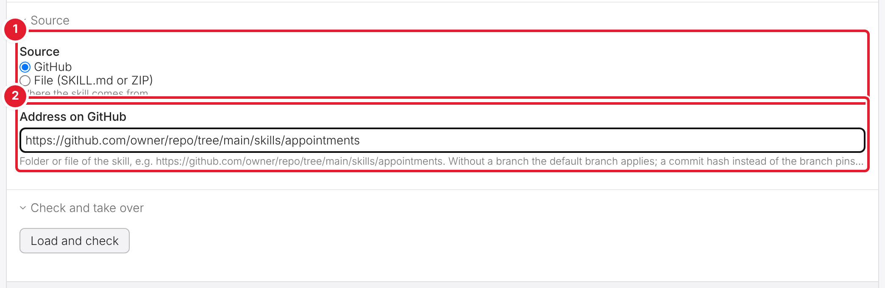

# Installed skills

A skill is a short set of rules for the model in one area, e.g. "stays with
pets" or "proof of identity before a booking is shown". The extension ships its
own skills (core, navigation, contact, web search, referral, medical, privacy);
administrators add more with the button **Skills** above the list of
assistants. Shipped skills cannot be changed, and installed skills may not use
their names.

Prerequisites: a licence for Plus or Pro, its terms confirmed; the user is an
administrator.

## Installing a skill

1. Click **Skills** and then **New skill**.
2. **Source**:
   - **GitHub**: **Address on GitHub** of the skill folder or its `SKILL.md`,
     e.g. `https://github.com/owner/repo/tree/main/skills/appointments`.
     Without a branch the default branch applies; a commit hash instead of the
     branch pins a version. Public repositories only.
   - **File (SKILL.md or ZIP)**: a `SKILL.md`, or a ZIP with one `SKILL.md`,
     from the file manager or uploaded there. ZIP files need the PHP
     extension `zip`.
3. Save. The extension loads and checks the skill ("Loaded and checked. Read
   the text and take it over with the box below.").

In the picture: 1 **Source**, 2 **Address on GitHub**; below them the button
**Load and check**.

## The check

| Rule | Message when it fails |
| --- | --- |
| A header with `name` and `description` between two lines `---` at the start | "The header with name and description … is missing at the start." |
| `name`: lower-case letters, digits and hyphens, starting with a letter, at most 64 characters | "The name "…" is invalid: …" |
| `name` not used by a shipped or another installed skill | "The name "…" is already used …" |
| `description` present (it tells the model when to load the skill), at most 300 characters | "The description is missing. …" / "The description has … characters, at most … are allowed." |
| The text not empty, at most 2,800 characters; longer skills are not followed reliably | "The text has … characters, at most … are allowed. Split it into several smaller skills." |
| Dependencies (`depends:`) exist | "The skill builds on "…" (depends), which does not exist here." |
| Tools the skill names (`tools:`) exist in a connection | a note, not an error: "The tool "…" (tools) exists in no connection. …" |

Only the `SKILL.md` is used: other files of a ZIP are named ("Not taken over
(only the SKILL.md counts, nothing is run): …") and ignored. Nothing is ever
run.

## Taking a skill over

The form shows the full text as the model gets it. It applies only after the
checkbox **I have read the content and take it over.** and saving. Who took it
over and when is kept ("Taken over: …, by … on …"). The manufacturer of the
extension checks only the structure of a skill, not its content.

## Updates

**Check for a new version** loads the source again. A changed text is shown
with its changes against the version taken over and applies only after the same
confirmation; otherwise "No new version: the text is unchanged." Nothing is
fetched while the chat runs.

GitHub is reached from the back end only, when an administrator loads a skill
(`raw.githubusercontent.com`, no GitHub API, no visitor data).

## Choosing skills at the assistant

In the assistant, section **Installed skills**, tick which skills it may use;
nothing is ticked by default. The model sees them in its catalogue and loads one
itself when a question falls into its area; the tools the skill names come with
it. If a skill is renamed, assistants that ticked the old name need to tick it
again.
